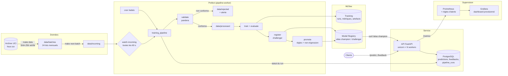

# bikeshare-mlops

Projet final 5MLDE (Supinfo) : **industrialiser un modèle de Machine Learning**.
Le modèle prévoit le **nombre de locations de vélos par heure** (régression) ; l'enjeu n'est pas sa
performance mais la chaîne MLOps complète, reproductible et démontrée de bout en bout :
ingestion vérifiée → contrôles qualité bloquants → entraînement tracé → registre et règles de
promotion → orchestration → API persistée → supervision → tests de charge.

Décisions techniques, preuves et dimensionnement : [`docs/SYNTHESE.md`](docs/SYNTHESE.md).

## Architecture



| Brique | Outil | Rôle |
|---|---|---|
| Configuration | YAML + pydantic-settings | `config/config.yaml`, surchargeable par variables d'environnement |
| Qualité des données | pandera | schéma, types, plages, nulls, doublons, cohérence, volume |
| Modèle | scikit-learn | pipeline prétraitement + RandomForest, baseline naïve |
| Tracking / registre | MLflow (PostgreSQL + artefacts servis) | runs, versions, alias `champion` / `challenger` |
| Orchestration | Prefect 3 | flows, retries, déclenchement à l'arrivée d'un lot, cron, alertes |
| API | FastAPI + pydantic + uvicorn | prédictions unitaires/lot, feedbacks, santé, modèle |
| Persistance | PostgreSQL + SQLAlchemy + Alembic | prédictions, feedbacks, runs de pipeline |
| Supervision | Prometheus + Grafana | métriques, alertes, dashboard provisionné |
| Charge | Locust | matrice de configurations, recommandation chiffrée |
| Qualité du code | ruff, pytest, pytest-cov, GitHub Actions | lint + tests à chaque push |

## Données

- **Source :** [UCI Machine Learning Repository, Bike Sharing Dataset](https://archive.ics.uci.edu/dataset/275/bike+sharing+dataset)
  (Fanaee-T, H. & Gama, J., 2013), fichier `hour.csv` : 17 379 relevés horaires, 2011-2012,
  système Capital Bikeshare (Washington D.C.).
- **Licence :** [CC BY 4.0](https://creativecommons.org/licenses/by/4.0/) : réutilisation libre
  avec citation de la source.
- **Récupération :** `make data` télécharge l'archive officielle
  (https://archive.ics.uci.edu/static/public/275/bike+sharing+dataset.zip), vérifie son SHA-256
  (fixé dans `config/config.yaml`) et ne la retélécharge pas si elle est déjà présente et intègre.
  Aucune donnée n'est versionnée (`/data/` est dans `.gitignore`).
- **Simulation de nouvelles données :** le dataset est découpé par mois en 24 lots
  (`data/batches/batch_YYYY_MM.csv`) rejoués un par un : `make next-batch` fait « arriver » le lot
  suivant dans `data/incoming/`, comme le ferait un export mensuel du système de location. Un lot
  traité part dans `data/processed/` (cumul servant à l'entraînement) ou `data/rejected/`.
- `casual` et `registered` sont exclues des variables : leur somme est exactement la cible `cnt`.

## Prérequis

- [uv](https://docs.astral.sh/uv/) (installe Python 3.11 et les dépendances figées de `uv.lock`)
- GNU Make
- Docker + Docker Compose v2 (≈ 4 Go de RAM libres pour la stack complète)
- Ports libres : 3000, 4200, 5000, 5432, 8000, 9090

## Reproduire de zéro

```bash
git clone https://github.com/Wkissi/bikeshare-mlops.git && cd bikeshare-mlops
cp .env.example .env      # optionnel : identifiants locaux, webhook d'alerte
make install              # Python 3.11 + dépendances figées
make test                 # lint et tests ne demandent ni Docker ni Internet
make data                 # téléchargement vérifié + 24 lots mensuels
make up                   # construit l'image et démarre les 8 services
make demo-nominal         # 1er lancement : 2011 entier → modèle entraîné et promu → trafic
make demo-incident        # lot invalide bloqué, pannes PostgreSQL et MLflow
make load-test            # optionnel (~35 min) : matrice de charge → docs/load_tests/
make load-test-fine       # optionnel (~9 min) : paliers fins sur les configurations candidates
```

`make help` liste toutes les commandes. `make down` arrête la stack (les volumes sont conservés).

> **Durée de `make test` sous Windows :** compter environ 4 à 5 minutes (4 min 23 mesurées sur un
> clone propre), contre moins de 2 minutes sous Linux en CI. L'écart vient des tests
> d'intégration des pipelines (`tests/integration/test_pipelines.py`), qui démarrent un serveur
> Prefect temporaire (`prefect_test_harness`) dont le lancement est nettement plus lent sous
> Windows. Les tests ne sont pas bloqués : il suffit d'attendre la fin.

## Services

| Service | URL | Contenu |
|---|---|---|
| API | http://localhost:8000/docs | documentation interactive, essai des routes |
| Grafana | http://localhost:3000 | dashboard « Bikeshare MLOps » (lecture sans compte ; admin/admin pour éditer) |
| Prometheus | http://localhost:9090/alerts | métriques et règles d'alerte |
| MLflow | http://localhost:5000 | expériences `bikeshare-demand`, `bikeshare-ingestion` ; registre `bikeshare-rf` |
| Prefect | http://localhost:4200 | déploiements et runs des flows |
| PostgreSQL | `localhost:5432` | bases `bikeshare` (application), `mlflow`, `prefect` |

## Déroulé des démonstrations

**`make demo-nominal`** :
1. vérifie que les services répondent, prépare les données si besoin ;
2. dépose le lot suivant (les 12 mois de 2011 au premier lancement, quand aucun champion n'existe) ;
3. le worker Prefect détecte le lot, le valide, entraîne, enregistre le challenger et applique les
   règles de promotion ; la décision s'affiche ;
4. l'API bascule d'elle-même sur le nouveau champion (suivi de l'alias, ≤ 30 s) ;
5. 300 prédictions unitaires et 5 lots sont envoyés, puis les valeurs réellement observées en
   feedback → courbes de trafic, de latence, de prédictions par version et de MAE dans Grafana.

**`make demo-incident`** (`HOLD=60` pour maintenir la panne plus longtemps) :
- (a) **lot invalide** (colonne manquante, valeurs hors plage, nulls, doublons) → rapport de
  validation, lot en quarantaine, flow en échec **avant** l'entraînement, alerte
  (`make alerts`, log Prefect, webhook si configuré), tuile « Dernier entraînement » en échec ;
- (b) **PostgreSQL arrêté** → réponses 503 `database_unavailable` propres, `/health` en
  `degraded`, alertes Prometheus `DatabaseDown` et `HighServerErrorRate`, tuile rouge dans Grafana,
  puis retour automatique à la normale au redémarrage ;
- (c) **MLflow arrêté** → `/model/reload` échoue en quelques secondes avec un message clair, le
  modèle en mémoire continue d'être servi.

## Cycle de vie du modèle

| Commande | Effet |
|---|---|
| `make train-local` | entraîne et évalue sans MLflow (`reports/training/`) |
| `make train DATA_DIR=data/processed` | entraîne, trace le run, enregistre la version en `challenger` |
| `make promote` | compare challenger et champion sur le même jeu de test, promeut ou rejette (tag motivé) |
| `make models` | versions, alias, statut de promotion |
| `make rollback VERSION=n` | remet l'alias `champion` sur la version `n` (appliqué par l'API en ≤ 30 s) |
| `make pipeline` | exécute `training_pipeline` une fois depuis l'hôte (`RETRAIN=1` sans nouveau lot) |
| `make predict-batch FILE=...` | prédiction par lot avec le champion (`data/predictions/`) |

Règles de promotion (`config/config.yaml` > `promotion`) : le challenger doit passer **tous** les
tests de non-régression (prédictions finies et positives, RMSE au moins 30 % sous la baseline,
mêmes colonnes d'entrée que le champion, aucune saison dégradée de plus de 10 %, prédiction
unitaire sous 200 ms) **et** battre le RMSE du champion d'au moins 2 % sur le même jeu de test.

## API

| Route | Rôle |
|---|---|
| `POST /predict` | une heure → `prediction`, `model_name`, `model_version`, `prediction_id`, `latency_ms` |
| `POST /predict/batch` | jusqu'à 1 000 heures (`batch_id` + un `prediction_id` par ligne) |
| `POST /feedback` | `prediction_id` + valeur observée `actual` → erreur absolue enregistrée |
| `GET /health` | 200 `ok` / 503 `degraded` : base, modèle, dernier run de pipeline |
| `GET /model`, `POST /model/reload` | version servie ; rechargement forcé |
| `GET /metrics` | métriques Prometheus agrégées sur tous les workers |

```bash
curl -X POST localhost:8000/predict -H "Content-Type: application/json" \
  -d '{"season":3,"yr":1,"mnth":7,"hr":17,"holiday":0,"weekday":3,"workingday":1,"weathersit":1,"temp":0.72,"atemp":0.66,"hum":0.45,"windspeed":0.19}'
```

Erreurs : 422 `validation_error` (liste des champs fautifs), 404/409 (feedback), 503
`database_unavailable` / `model_unavailable`, 500 `internal_error` (détail dans les logs seulement).

## Configuration

Toute la configuration est dans [`config/config.yaml`](config/config.yaml) : chemins,
hyperparamètres, seuils qualité, règles de promotion, orchestration, alertes, base, API. Chaque clé
se surcharge par variable d'environnement `BIKESHARE_<SECTION>__<CLE>` (voir `.env.example`), par
exemple `BIKESHARE_TRAINING__MODEL__N_ESTIMATORS=100`. Aucun secret n'est versionné.

## Arborescence

```
config/              configuration unique (YAML)
src/bikeshare_mlops/
  data/              ingestion, contrôles qualité, assemblage du jeu d'entraînement
  features/          prétraitement sklearn (sérialisé avec le modèle)
  models/            baseline, entraînement, évaluation, registre, promotion
  pipelines/         flows Prefect et déploiements
  api/               application FastAPI
  storage/           tables SQLAlchemy et accès aux données
  monitoring/        métriques Prometheus, simulateur de trafic
  utils/             logs JSON, alertes, empreintes
migrations/          migrations Alembic
tests/               unit/ et integration/ (aucun accès réseau)
load_tests/          scénario Locust, matrice de configurations, analyse
scripts/             lot invalide, démonstrations
docker/              Dockerfile, initialisation PostgreSQL
monitoring/          configuration Prometheus et Grafana (provisionnée)
docs/                synthèse, résultats de charge, captures
```
