# Synthèse technique : bikeshare-mlops

Projet final 5MLDE : industrialiser un modèle de prévision des locations horaires de vélos
(UCI Bike Sharing, régression). Ce document justifie les choix, montre comment les données et les
artefacts circulent, liste les contrôles et les incidents gérés, donne les résultats des tests de
charge et le dimensionnement recommandé, puis les limites connues.

## 1. Vue d'ensemble

La chaîne complète tourne en local avec `docker compose` (8 services) et se pilote par `make` :

1. **Ingestion** : archive UCI téléchargée une fois, vérifiée par SHA-256, découpée en 24 lots
   mensuels rejoués un par un (`data/incoming/`) pour simuler l'arrivée de nouvelles données.
2. **Contrôle qualité** (pandera), **avant** tout prétraitement : un lot non conforme est mis en
   quarantaine, son rapport archivé, le pipeline s'arrête et une alerte part.
3. **Entraînement** sur le cumul des lots validés, **évaluation** contre une baseline,
   **traçage** complet dans MLflow, **enregistrement** de la version en `challenger`.
4. **Promotion** : le challenger devient `champion` seulement s'il bat le champion d'au moins 2 %
   sur le même jeu de test et passe les tests de non-régression ; sinon, rejet avec un tag motivé.
5. **Service** : l'API FastAPI suit l'alias `champion`, valide strictement les entrées, enregistre
   chaque prédiction et chaque feedback dans PostgreSQL.
6. **Supervision** : Prometheus collecte trafic, latences, erreurs, prédictions par version, MAE
   glissante issue des feedbacks et statut des pipelines ; Grafana affiche un dashboard provisionné ;
   7 règles d'alerte.

### Circulation des données et des artefacts

| Artefact | Produit par | Stocké dans | Consommé par |
|---|---|---|---|
| Archive UCI + empreinte | `make data` | `data/raw/` (hash dans la config) | découpage en lots |
| Lots mensuels | ingestion | `data/batches/` → `incoming/` → `processed/` ou `rejected/` | pipeline d'entraînement |
| Rapport de validation (JSON) | `validate` | `reports/validation/` + run MLflow `bikeshare-ingestion` | humain, alerte |
| Métadonnées de lot (hash, lignes, période) | `log-ingestion` | MLflow `bikeshare-ingestion` ; `data/batches.json` du run d'entraînement | traçabilité |
| Modèle (pipeline sklearn complet) | `train` | MLflow (artefacts servis, sérialisation skops) | `promote`, API, prédiction par lot |
| Métriques, graphiques, signature, exemple d'entrée | `train` / `evaluate` | run MLflow `bikeshare-demand` | décision, revue |
| Hash des données, commit du code | `train` | tags du run et de la version | traçabilité, reproductibilité |
| Décision de promotion | `promote` | tags de la version (`promotion_status`, `promotion_reason`, `eval_checks`) | `make models`, UI MLflow |
| Alias `champion` / `challenger` | `promote`, `rollback` | registre MLflow | API (suivi de l'alias) |
| Prédictions, feedbacks | API | PostgreSQL `predictions`, `feedbacks` | MAE glissante, audit |
| Statut des runs de pipeline | `training_pipeline` | PostgreSQL `pipeline_runs` | `/health`, métriques, Grafana |
| Alertes | hook d'échec Prefect | `logs/alerts.jsonl` + webhook optionnel + log Prefect | exploitation |

## 2. Décisions techniques

Chaque choix suit la consigne « l'option la plus simple qui satisfait le barème ».

### Socle et reproductibilité

- **Python 3.11 + uv + `uv.lock`** : `uv sync --frozen` installe exactement les mêmes versions
  partout (poste, CI, image Docker). Le lock a aussi servi de garde-fou : trois incompatibilités
  entre dépendances (cf. § 5) ont été corrigées en bornant les versions, avec une justification
  dans `pyproject.toml`.
- **Makefile comme point d'entrée unique** : recettes volontairement simples (compatibles `cmd`
  sous Windows et `sh` en CI), toute la logique est dans des modules Python testés.
- **Une image applicative unique** construite depuis le lock et réutilisée par MLflow, Prefect,
  le worker, l'API et les migrations : aucune divergence de versions entre services. Utilisateur
  non-root ; le commit Git est injecté à la construction (`CODE_VERSION`) et tracé dans chaque run.
- **Configuration** : un seul `config/config.yaml` (chemins, hyperparamètres, seuils qualité,
  règles de promotion, orchestration, alertes, base, API) chargé par pydantic-settings et surchargé
  par `BIKESHARE_<SECTION>__<CLE>`. Les sections refusent toute clé inconnue : une faute de frappe
  dans un seuil bloque le démarrage au lieu d'être ignorée. Les secrets (URL de base, webhook) ne
  passent que par l'environnement ; `.env.example` n'en contient aucun.
- **Logs JSON** (une ligne par événement, champs structurés) : exploitables par un outil
  d'agrégation sans parsing.

### Données et qualité

- **Simulation de flux par lots mensuels** : réaliste (un export mensuel), déterministe, et elle
  permet de démontrer le réentraînement et la promotion au fil de l'eau.
- **pandera** : schéma déclaratif lisible (types, plages des variables normalisées, nulls,
  doublons sur `(dteday, hr)`, cohérence `cnt = casual + registered`, volume minimum de 500
  lignes, colonnes inconnues refusées). Mode `lazy` : toutes les anomalies sont collectées en une
  passe ; le rapport JSON les regroupe par contrôle. Le même schéma, restreint aux variables
  explicatives, valide les fichiers de prédiction par lot.
- **Pourquoi avant le prétraitement** : un lot corrompu ne doit jamais produire un modèle
  silencieusement faux ; l'échec est explicite, tracé et alerté.

### Modèle

- **Pipeline sklearn unique** (encodage cyclique sin/cos de l'heure, du mois et du jour,
  one-hot de la saison et de la météo, puis RandomForest), sérialisé d'un bloc : l'API applique
  exactement la transformation vue à l'entraînement (pas de *training-serving skew*).
- **Baseline** = moyenne historique par (heure, jour ouvré). Elle sert de plancher : un modèle
  qui ne la bat pas de 30 % est rejeté.
- **Découpage train/test par hash de `(date, heure)`** : un relevé est toujours du même côté, même
  quand des lots arrivent. Champion et challenger sont donc comparés sur un jeu de test commun, et
  aucune ligne de test ne fuit dans l'entraînement d'une version suivante.
- **Taille de la forêt arbitrée par l'exploitation** (mesuré sur les 24 mois) :

  | Forêt | RMSE test | Taille du modèle | Prédiction unitaire |
  |---|---|---|---|
  | 200 arbres, profondeur 20 | 42,2 | 107 Mo | 22,5 ms |
  | **60 arbres, profondeur 15** (retenu) | 43,1 (+2 %) | 17,6 Mo | 9,5 ms |

  La performance n'étant pas évaluée, 2 % de RMSE ne valent pas un modèle 6 fois plus lourd et
  2,4 fois plus lent à servir. Inférence forcée en mono-thread (`n_jobs=1` après entraînement) pour
  ne pas créer de pool de threads à chaque requête.

### Tracking, registre, promotion

- **MLflow** avec backend PostgreSQL (concurrence entre worker, API et hôte) et **artefacts servis
  par le serveur** (`--serve-artifacts`) : les clients envoient les artefacts en HTTP, aucun
  volume partagé ni chemin Windows/Linux à concilier.
- Chaque run trace : hyperparamètres, volumes, RMSE/MAE/R² globaux et par saison, baseline,
  **hash des données**, **commit du code**, liste des lots utilisés, jeu de test (`log_input`),
  4 graphiques, **signature** et **exemple d'entrée**.
- **Sérialisation skops** (défaut de MLflow 3) plutôt que pickle : seuls les types déclarés de
  confiance (`CyclicalEncoder`, `sklearn.tree._tree.Tree`) peuvent être rechargés.
- **Alias plutôt que stages** : `champion` = version servie, `challenger` = candidate. Promouvoir
  ou revenir en arrière = déplacer un pointeur, sans redéployer l'API.
- **Règles de promotion** (`promotion` dans la config) : tests de non-régression obligatoires
  (prédictions finies et ≥ 0, RMSE ≥ 30 % sous la baseline, colonnes d'entrée identiques au
  champion, aucune saison dégradée de plus de 10 %, prédiction unitaire < 200 ms), puis gain de
  RMSE ≥ 2 % sur le champion. Le résultat de chaque test est enregistré en tag (`eval_checks`).
- **Rollback** : `make rollback VERSION=n` remet l'alias, marque l'ancien champion
  `rolled_back` ; l'API l'applique d'elle-même en moins de 30 s.

### Orchestration

- **Prefect 3, déploiements servis par un conteneur** (`serve()`), plutôt que work pools et
  workers séparés : un seul processus, suffisant en local, `limit=1` empêche deux entraînements
  simultanés.
- **Déclenchement à l'arrivée d'un lot** par un flow de surveillance toutes les 60 s : Prefect
  OSS en local n'a pas de déclencheur natif sur fichier ; le flow ne fait rien s'il n'y a rien.
  Un **cron hebdomadaire** réentraîne sur toutes les données validées.
- **Retries uniquement sur les tâches réseau** (MLflow : 3 essais, 10 s) : relancer une
  validation ou un entraînement déterministe ne changerait rien.
- **Alertes** par hook d'échec : fichier JSONL (toujours), log Prefect, webhook Slack/Discord si
  configuré. Un webhook en panne est journalisé mais ne masque jamais l'incident d'origine.

### API et persistance

- **FastAPI + pydantic en mode strict** : types exacts (`"17"` ou `17.5` refusés pour l'heure),
  plages du dataset, champ inconnu refusé ; 422 avec la liste des champs en cause.
- **Format d'erreur unique** `{error, message, details}` et codes explicites : 404/409 pour le
  feedback, 503 pour une dépendance indisponible, 500 sans détail interne (détail dans les logs).
- **Base indisponible → 503 plutôt qu'une prédiction non tracée** : la traçabilité (chaque
  prédiction a un `prediction_id` utilisable pour le feedback) prime sur la disponibilité. Délai
  de connexion de 3 s et `pool_pre_ping` : l'erreur arrive en quelques secondes, et le service
  reprend seul au retour de la base.
- **Modèle** : chargé au démarrage ; si le registre est injoignable, l'API démarre en mode
  dégradé puis charge le modèle dès qu'il revient. Chaque worker uvicorn vérifie l'alias toutes
  les 30 s : un `POST /model/reload` ne touche qu'un worker, la vérification périodique garantit
  que tous convergent. Un rechargement raté conserve le modèle servi.
- **SQLAlchemy + Alembic** (service `migrate` exécuté avant l'API et le worker) : le schéma est
  versionné ; un test vérifie que la migration produit exactement le schéma des modèles ORM et que
  le retour arrière nettoie tout.
- Les prédictions **en échec** sont aussi enregistrées (statut, erreur) quand la base répond.

### Supervision

- **prometheus-fastapi-instrumentator** pour le trafic HTTP (requêtes par route et code,
  histogramme de latence → p50/p95/p99 dans Grafana) + **métriques métier** (prédictions par
  version et statut, feedbacks, erreurs par type, temps d'inférence, version servie).
- **Mode multiprocessus** : avec plusieurs workers uvicorn, chaque worker écrit ses compteurs dans
  un dossier commun et `/metrics` les agrège ; sans cela, Prometheus verrait des valeurs qui
  sautent selon le worker interrogé.
- **Indicateurs relus en base à chaque collecte** (MAE glissante sur les 200 derniers feedbacks,
  dernier run de pipeline, base joignable) : cohérents quel que soit le worker et justes après un
  redémarrage.
- **Grafana provisionné** (source de données + dashboard JSON versionnés) : 16 panneaux en trois
  lignes (état du service, trafic et latence, modèle et qualité). Couleurs : palette catégorielle
  en ordre fixe pour les séries, vert/rouge réservés aux tuiles d'état, toujours avec un libellé.
- **7 règles d'alerte Prometheus** : `ApiDown`, `DatabaseDown`, `ModelNotLoaded`,
  `HighServerErrorRate`, `HighPredictionLatencyP95`, `TrainingPipelineFailed`, `RollingMaeDegraded`.

### Tests et CI

- 110 tests (unitaires et d'intégration), couverture de 95 %, **aucun accès réseau** :
  données synthétiques, serveur HTTP simulé, MLflow sur SQLite jetable, serveur Prefect de test.
- Tests d'intégration réels : API (TestClient + modèle factice + SQLite), flows Prefect sur des
  lots synthétiques (nominal, lot invalide, lot valide en attente), cycle de vie du registre,
  migrations, métriques, simulateur de trafic.
- **Garde-fous de test** (fixtures automatiques) : chaque test a ses propres chemins, sa base et
  son MLflow ; aucun test ne peut écrire dans les vraies données ou le vrai registre (deux
  incidents de ce type ont motivé ces garde-fous, cf. § 5).
- **CI GitHub Actions** : `make install`, `make lint` (ruff), `make test` à chaque push.

## 3. Fiabilité et traçabilité

### Contrôles bloquants

| Contrôle | Où | Effet en cas d'échec |
|---|---|---|
| Empreinte SHA-256 de l'archive | ingestion | téléchargement rejeté, aucun fichier partiel |
| Schéma pandera du lot | `training_pipeline` | quarantaine, rapport, flow en échec avant entraînement, alerte |
| Volume minimal d'entraînement | entraînement | `InsufficientDataError` |
| Tests de non-régression + gain ≥ 2 % | promotion | version rejetée, tag motivé, champion inchangé |
| Validation stricte des entrées | API | 422 explicite, rien n'est prédit |
| Validation de la configuration | démarrage de chaque composant | refus de démarrer |
| Lint + tests (dont garde-fou de compatibilité Prefect) | CI | push signalé en échec |

### Incidents gérés (démontrés par `make demo-incident`)

| Incident | Détection | Réaction | Visible dans |
|---|---|---|---|
| Lot invalide | pandera | quarantaine, flow en échec, pas d'entraînement | alerte JSONL/webhook, Prefect, MLflow (ingestion `rejected`), Grafana « Dernier entraînement », alerte `TrainingPipelineFailed` |
| PostgreSQL arrêté | erreur SQLAlchemy, `/health` | 503 `database_unavailable` en ~4 s, reprise automatique | `/health` 503, Grafana « Base de données » rouge, pic de 503, alertes `DatabaseDown`, `HighServerErrorRate` |
| MLflow arrêté | échec du rechargement | modèle courant conservé, 503 clair sur `/model/reload` | réponse de l'API, logs |
| Modèle introuvable au démarrage | chargement | démarrage dégradé, chargement automatique au retour du registre | `/health`, alerte `ModelNotLoaded` |
| Panne réseau vers MLflow pendant le pipeline | exception | 3 nouvelles tentatives, puis échec alerté | Prefect, alerte |

### Suivi des versions

- **Données** : hash de l'archive (config), hash de chaque lot (run d'ingestion), hash du jeu
  d'entraînement (tag du run et de la version).
- **Code** : commit Git (`code_version`) sur chaque run.
- **Modèle** : version du registre, alias, statut et motif de promotion, `run_id` d'origine.
- **Prédictions** : chaque ligne de `predictions` porte la version du modèle qui l'a produite.

## 4. Tests de charge et dimensionnement

Résultats complets (33 mesures, tableau, graphiques) : [`docs/load_tests/RESULTATS.md`](load_tests/RESULTATS.md).
Reproduire : `make load-test` (~35 min) puis `make load-test-fine` (~9 min).

### Protocole

- **Charge** : Locust en mode headless depuis l'hôte. Chaque utilisateur virtuel enchaîne
  80 % de `/predict`, 10 % de `/predict/batch` (10 heures) et 10 % de `/feedback`, avec 0,5 à
  1 s de réflexion entre deux requêtes (≈ 1,2 requête/s par utilisateur). Les heures envoyées
  sont tirées d'un lot réel. 40 s mesurées par test, statistiques remises à zéro après la
  montée en charge, échauffement de l'API avant chaque configuration.
- **Matrice** : 3 profils de ressources appliqués au seul conteneur de l'API
  (`deploy.resources` : 1 vCPU / 512 Mo, 2 vCPU / 1 Go, 4 vCPU / 2 Go) × 1, 2 ou 4 workers
  uvicorn × 10, 50 et 100 utilisateurs, puis paliers fins 10-20-30-40 sur les deux
  configurations candidates. PostgreSQL et MLflow ne sont pas limités.
- **Mesures** : débit, latences p50/p95/p99 (globales et de `/predict`), taux d'erreur
  (Locust), CPU moyen et maximal, mémoire maximale (`docker stats` toutes les 2 s).
- **Objectif de service (SLO)** : p95 de `/predict` < 200 ms **et** < 1 % d'erreurs.
  **Besoin cible** : 100 requêtes/s.

### Résultats clés

| Ressources | Workers | Débit max sous SLO | Comportement au-delà |
|---|---|---|---|
| 1 vCPU / 512 Mo | 1 | 12 req/s (10 utilisateurs) | plafond à 19 req/s, p95 à 3 s dès 50 utilisateurs |
| 1 vCPU / 512 Mo | 4 | jamais tenu | mémoire saturée : 23 à 98 % d'erreurs |
| 2 vCPU / 1 Go | 1 | 12 req/s | un seul cœur utilisé (CPU ≈ 100 %), plafond à 30 req/s |
| **2 vCPU / 1 Go** | **2** | **35 req/s (30 utilisateurs, p95 170 ms)** | 37 req/s à 40 utilisateurs mais p95 920 ms |
| 2 vCPU / 1 Go | 4 | 12 req/s | 4 × ~270 Mo : mémoire au plafond (1 Go), pas plus de débit que 2 workers |
| 4 vCPU / 2 Go | 2 | 36 req/s (30 utilisateurs, p95 180 ms) | aucun gain par rapport à 2 vCPU |
| 4 vCPU / 2 Go | 4 | ≥ 12 req/s | 56 req/s à 50 utilisateurs avec p95 270 ms (juste au-dessus du SLO) |

Ce que montrent les mesures :

1. **Un worker n'utilise qu'un cœur** (CPU plafonné vers 100 % même avec 2 ou 4 vCPU) : le verrou
   global de Python (GIL) sérialise le travail CPU d'un processus. Pour exploiter N vCPU, il faut
   environ N workers.
2. **Chaque worker coûte environ 280 Mo** (pandas, scikit-learn, MLflow et le modèle chargés dans
   chaque processus). 2 workers tiennent dans 1 Go (≈ 600 Mo mesurés) ; 4 workers ne tiennent ni
   dans 512 Mo (erreurs massives) ni confortablement dans 1 Go.
3. **Le coût est le CPU de l'API, pas la base** : environ 23 ms de CPU par prédiction (inférence
   d'une forêt sur une ligne, DataFrame, validation, ORM, sérialisation). Diagnostic à 50
   utilisateurs : PostgreSQL à 7 % de CPU, et passer le commit en asynchrone ne change presque
   rien (42 → 45 req/s). Une requête isolée prend 24 ms de bout en bout (12 ms d'inférence,
   8 ms d'écriture, 4 ms de HTTP).
4. **Au-delà de la saturation, la latence explose** (file d'attente) sans erreur : un p95
   multiplié par 5 à 20 est le signal à surveiller (alerte `HighPredictionLatencyP95`).

### Dimensionnement recommandé

> **Par instance : 2 workers uvicorn, 2 vCPU, 1 Go de RAM.** Elle tient **35 requêtes/s avec
> un p95 de /predict à 170 ms** (SLO < 200 ms), 0 % d'erreurs, ~68 % de CPU et ~600 Mo de
> mémoire.
> **Pour 100 requêtes/s : 3 instances** de cette taille derrière un répartiteur de charge
> (105 req/s de capacité, ~5 % de marge ; prévoir une 4ᵉ instance pour absorber la perte d'une
> instance ou un pic).

Pourquoi pas une seule grosse instance : 4 vCPU avec 2 workers n'apportent rien (36 req/s) ;
4 vCPU avec 4 workers montent à 56 req/s mais dépassent déjà le SLO (p95 270 ms) et demandent
2 Go. Trois petites instances coûtent 6 vCPU / 3 Go pour 105 req/s sous SLO et tolèrent mieux
une panne. C'est la configuration par défaut du `docker-compose.yml` (`API_WORKERS=2`,
`API_CPUS=2`, `API_MEMORY=1g`).

Limites de la mesure : Locust et la stack partagent la même machine (Docker Desktop, 12 cœurs) ;
la projection à 3 instances suppose une montée en charge linéaire, à confirmer par un test avec
répartiteur. Pistes pour augmenter la capacité par vCPU : prédire sur des tableaux NumPy plutôt
que des DataFrames, un modèle plus léger (moins d'arbres, ou gradient boosting compact),
l'écriture des prédictions en base hors du chemin de la requête.

## 5. Incidents rencontrés pendant le projet

Ces problèmes réels ont chacun laissé un garde-fou dans le code :

1. **FastAPI trop récent pour le serveur Prefect** (0.155 puis 0.151) : le serveur démarrait mais
   rejetait les requêtes de son propre client ; aucun run n'était planifié. Version bornée.
2. **SQLAlchemy 2.1** : le planificateur Prefect échouait à chaque insertion de runs. Version
   bornée. Les deux cas sont couverts par un test qui fait planifier un run à un vrai serveur
   Prefect, vérifié en échec avec les versions fautives.
3. **UI Prefect en 404** : le serveur, non-root, ne pouvait pas écrire son interface dans le venv.
   Dossier dédié inscriptible (`PREFECT_UI_STATIC_DIRECTORY`).
4. **`.gitignore` trop large** (`data/` excluait aussi `src/bikeshare_mlops/data/`) : détecté par
   la CI sur un clone propre. Motifs ancrés à la racine.
5. **Tests écrivant dans les vraies ressources** (un modèle synthétique dans le vrai registre,
   puis une alerte dans le vrai `logs/`) : nettoyés, puis fixtures d'isolation systématiques.

## 6. Preuves d'intégration

Captures à déposer dans `docs/img/` (liste et mode opératoire : [`docs/img/README.md`](img/README.md)).

| Preuve | Capture |
|---|---|
| Runs Prefect (déclenchement à l'arrivée des lots, échec du lot invalide) | 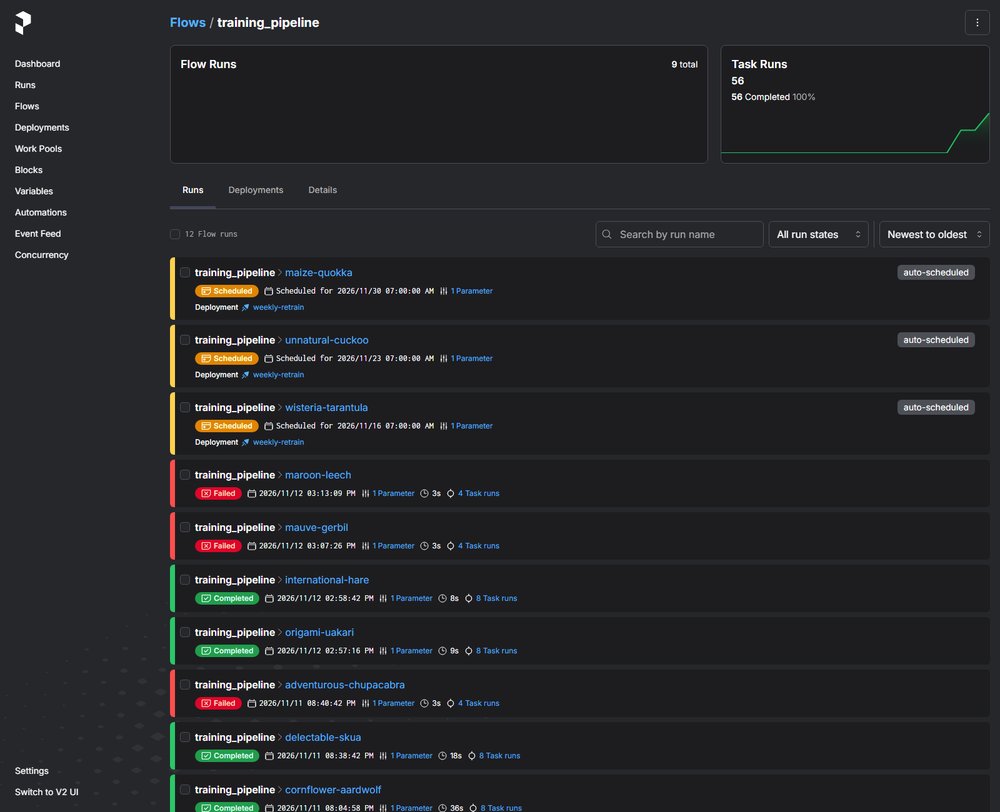 |
| Graphe d'un `training_pipeline` | 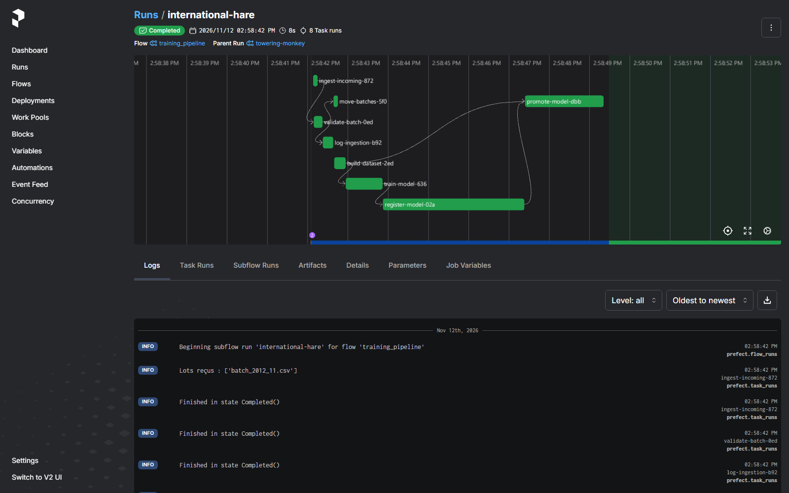 |
| Run MLflow : paramètres, métriques, hash des données, commit | 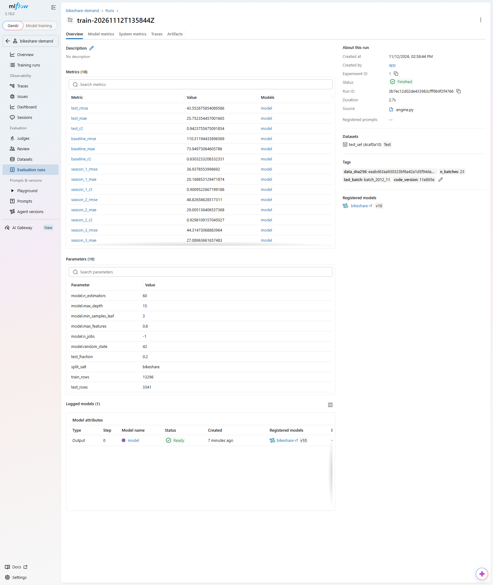 |
| Artefacts MLflow : graphiques d'évaluation | 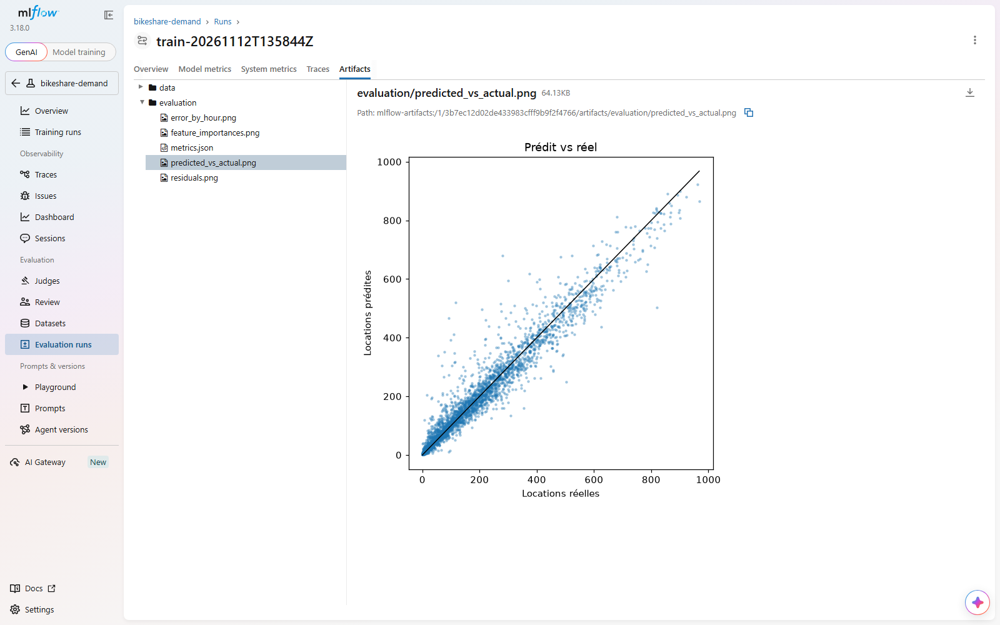 |
| Registre : alias et décisions de promotion | 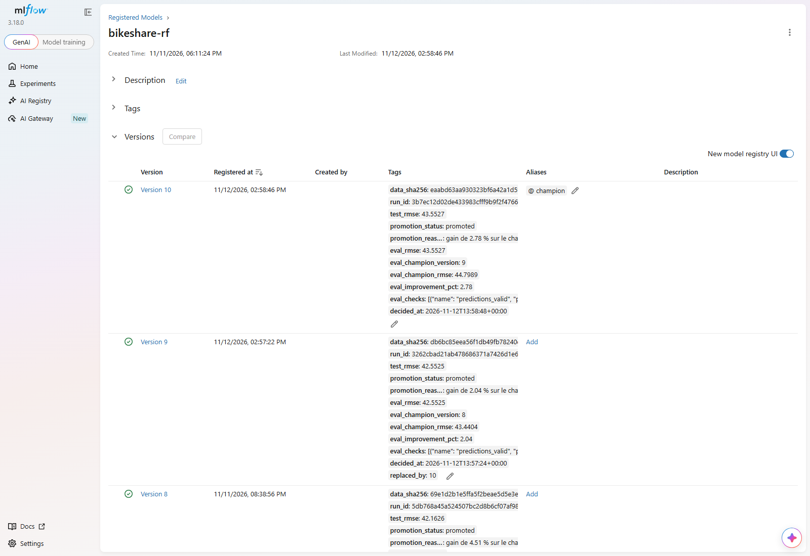 |
| Dashboard Grafana en fonctionnement nominal | 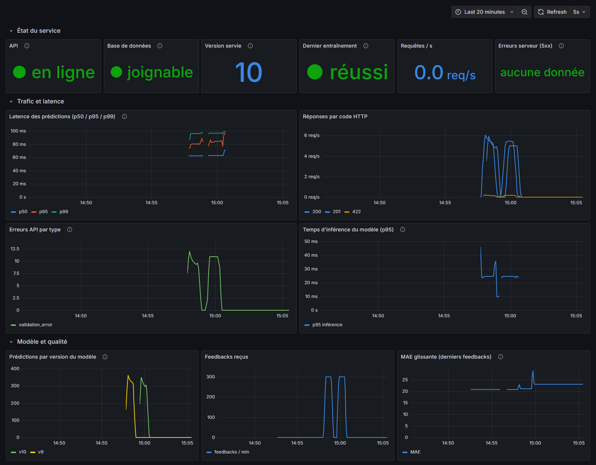 |
| Dashboard Grafana pendant la panne PostgreSQL | 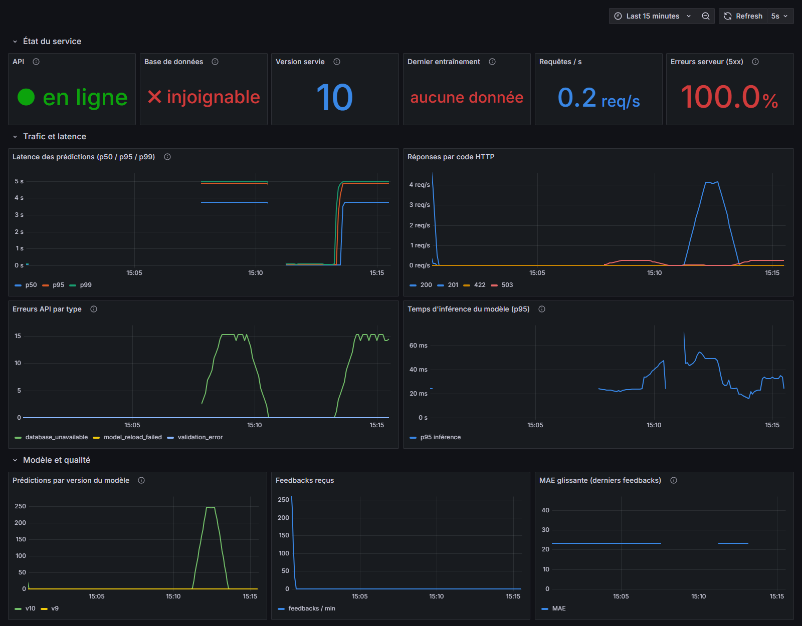 |
| Alertes Prometheus déclenchées | 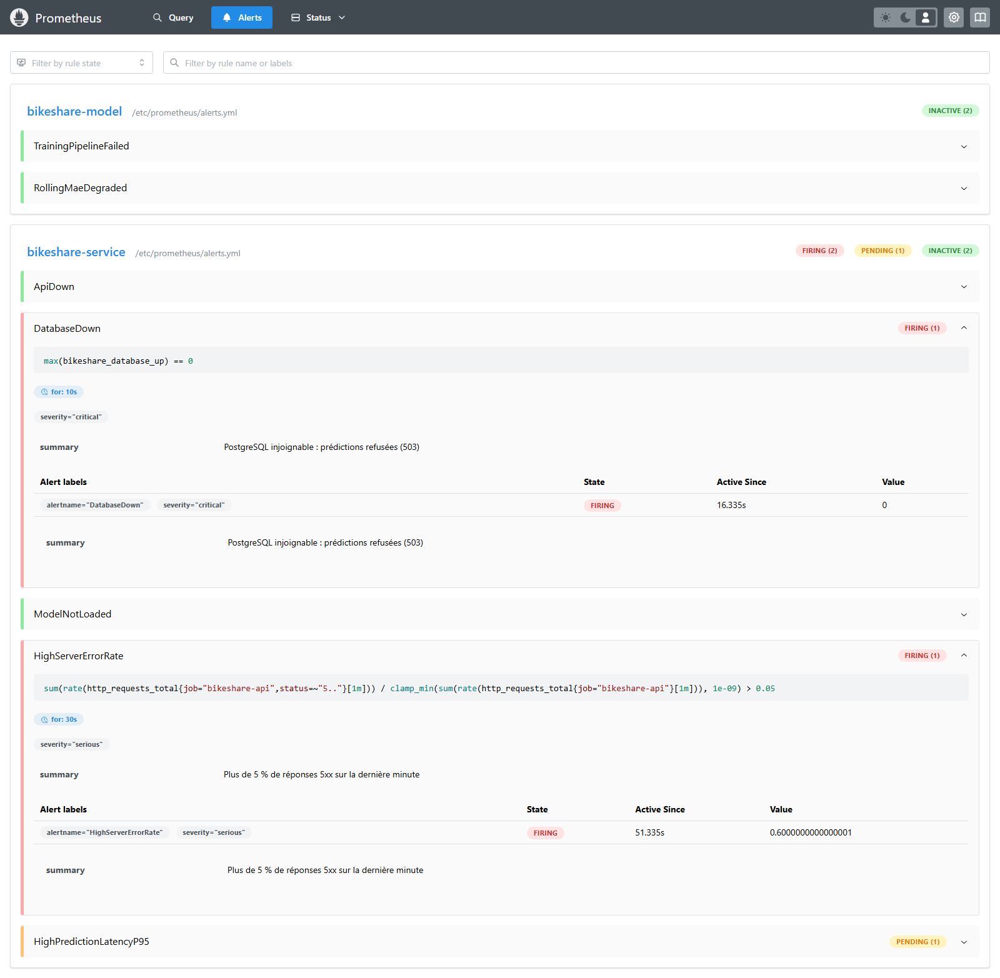 |
| `/health` dégradé | 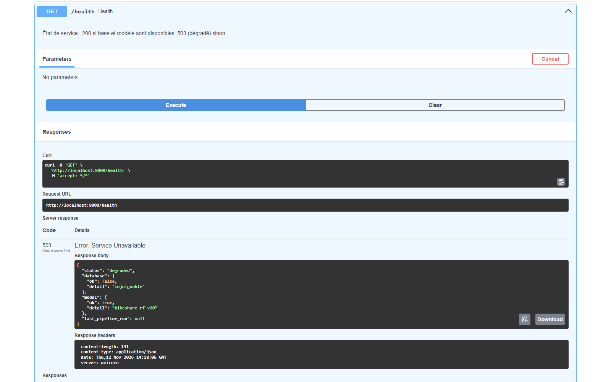 |
| Alerte du lot invalide et rapport de validation | 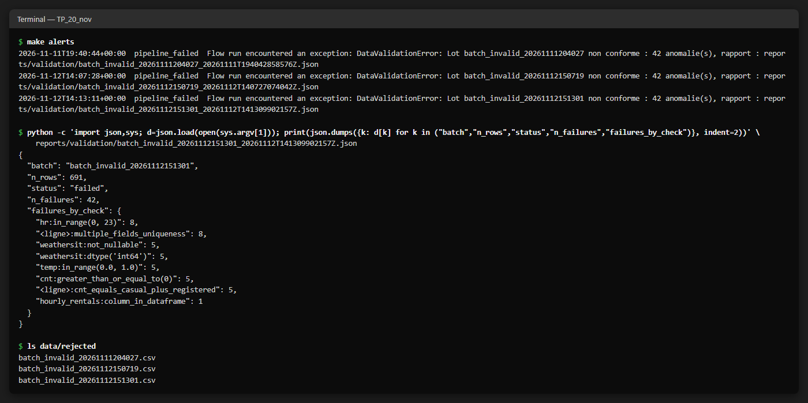 |
| CI GitHub Actions | 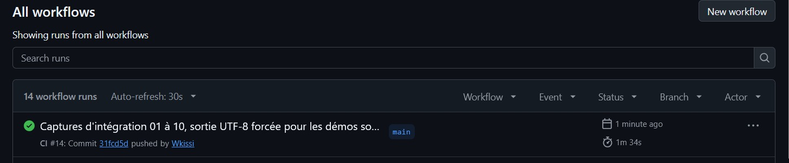 |

## 7. Limites connues et pistes d'amélioration

- **Découpage aléatoire (par hash), pas temporel** : le jeu de test contient des heures voisines
  d'heures d'entraînement, les métriques sont optimistes. Piste : validation temporelle
  (entraîner sur les mois passés, tester sur le mois suivant).
- **Feedback immédiat** : la simulation renvoie la vraie valeur aussitôt ; en réalité elle arrive
  après l'heure prévue. La MAE glissante reste valable mais avec un décalage.
- **Pas de détection de dérive des données** : seule la MAE des feedbacks surveille la qualité.
  Piste : comparer la distribution des entrées servies à celle de l'entraînement (Evidently, PSI).
- **Écriture synchrone en base à chaque prédiction** : coût de latence et dépendance forte à
  PostgreSQL. Piste : file d'écriture asynchrone, au prix d'une traçabilité différée.
- **Surveillance des lots par interrogation** (60 s) plutôt que par événement ; `serve()` dans un
  seul conteneur. Piste : work pool Prefect et événements.
- **Sécurité locale** : API sans authentification ni TLS, identifiants par défaut de Grafana et
  PostgreSQL. Piste : clé d'API ou OAuth2, secrets via un coffre, reverse proxy TLS.
- **Alertes Prometheus sans Alertmanager** : visibles dans Prometheus et Grafana, mais seules les
  alertes de pipeline sont poussées (webhook). Piste : Alertmanager vers le même webhook.
- **Tests de charge sur une seule machine** : Locust partage le CPU de l'hôte avec la stack ; les
  chiffres sont relatifs à ce poste (cf. § 4).
