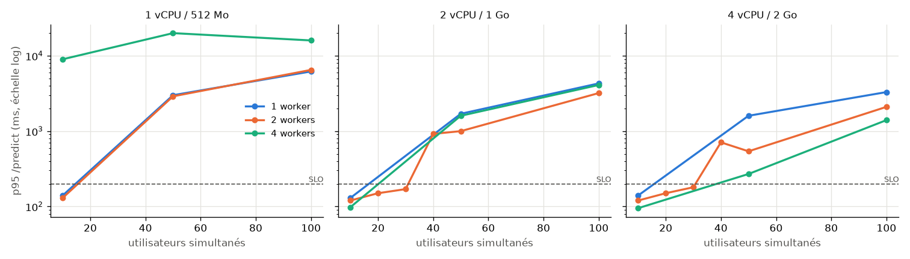
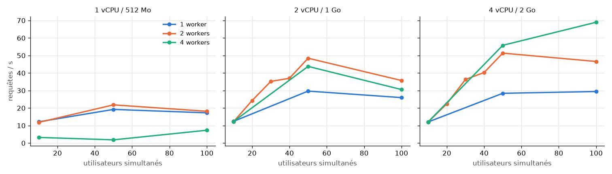
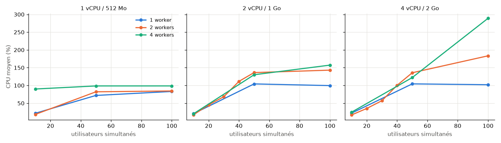

# Résultats des tests de charge

Protocole : API seule limitée en CPU et mémoire (`docker compose`, deploy.resources), PostgreSQL et MLflow non limités, même machine. Locust headless depuis l'hôte, 40 s mesurées par test après la montée en charge, temps de réflexion de 0,5 à 1 s par utilisateur ; 80 % /predict, 10 % /predict/batch (10 heures), 10 % /feedback. Objectif de service (SLO) : p95 de /predict < 200 ms et moins de 1 % d'erreurs. Besoin cible pour le dimensionnement : 100 requêtes/s.

## Recommandation

**2 worker(s) uvicorn, 2 vCPU, 1g par instance** : 35 requêtes/s avec 30 utilisateurs simultanés, p95 /predict = 170 ms (objectif < 200 ms), 0.00% d'erreurs, CPU moyen 68 %, mémoire max 591 Mo. À 100 utilisateurs, aucune configuration testée ne tient le SLO : la latence explose dès que le CPU sature, il faut répartir la charge sur plusieurs instances. Pour un besoin de 100 requêtes/s, prévoir **3 instance(s)** de cette taille derrière un répartiteur de charge (dimensionnement linéaire, à vérifier par un test sur plusieurs instances).

## Capacité de chaque configuration sous SLO

| Ressources | Workers | Débit max sous SLO | à N utilisateurs | p95 /predict |
|---|---|---|---|---|
| 1 vCPU / 512m | 1 | 12.2 req/s | 10 | 140 ms |
| 1 vCPU / 512m | 2 | 11.8 req/s | 10 | 130 ms |
| 1 vCPU / 512m | 4 | SLO jamais tenu | - | - |
| 2 vCPU / 1g | 1 | 12.4 req/s | 10 | 130 ms |
| 2 vCPU / 1g | 2 | 35.2 req/s | 30 | 170 ms |
| 2 vCPU / 1g | 4 | 12.3 req/s | 10 | 98 ms |
| 4 vCPU / 2g | 1 | 12.1 req/s | 10 | 140 ms |
| 4 vCPU / 2g | 2 | 36.3 req/s | 30 | 180 ms |
| 4 vCPU / 2g | 4 | 12.0 req/s | 10 | 95 ms |

## Mesures

| Ressources | Workers | Utilisateurs | Statut | req/s | p50 (ms) | p95 (ms) | p99 (ms) | p95 /predict (ms) | Erreurs | CPU moy. | CPU max | RAM max (Mo) | SLO |
|---|---|---|---|---|---|---|---|---|---|---|---|---|---|
| 1 vCPU / 512m | 1 | 10 | ok | 12.2 | 65 | 150 | 240 | 140 | 0.0% | 22 % | 45 % | 286 | oui |
| 1 vCPU / 512m | 1 | 50 | ok | 19.2 | 1800 | 3200 | 3900 | 3000 | 0.0% | 72 % | 99 % | 312 | non |
| 1 vCPU / 512m | 1 | 100 | ok | 17.3 | 4900 | 6300 | 7200 | 6200 | 0.0% | 83 % | 102 % | 316 | non |
| 1 vCPU / 512m | 2 | 10 | ok | 11.8 | 64 | 170 | 940 | 130 | 0.0% | 18 % | 36 % | 511 | oui |
| 1 vCPU / 512m | 2 | 50 | ok | 21.8 | 1500 | 3000 | 3600 | 2900 | 0.0% | 82 % | 101 % | 512 | non |
| 1 vCPU / 512m | 2 | 100 | ok | 18.2 | 4700 | 6600 | 7500 | 6500 | 0.0% | 84 % | 101 % | 512 | non |
| 1 vCPU / 512m | 4 | 10 | ok | 3.2 | 240 | 8800 | 9100 | 9000 | 22.7% | 90 % | 101 % | 512 | non |
| 1 vCPU / 512m | 4 | 50 | ok | 1.8 | 18000 | 20000 | 20000 | 20000 | 98.1% | 99 % | 105 % | 512 | non |
| 1 vCPU / 512m | 4 | 100 | ok | 7.3 | 10000 | 16000 | 17000 | 16000 | 33.8% | 99 % | 103 % | 512 | non |
| 2 vCPU / 1g | 1 | 10 | ok | 12.4 | 67 | 130 | 160 | 130 | 0.0% | 20 % | 33 % | 286 | oui |
| 2 vCPU / 1g | 1 | 50 | ok | 29.7 | 950 | 1700 | 2100 | 1700 | 0.0% | 104 % | 164 % | 311 | non |
| 2 vCPU / 1g | 1 | 100 | ok | 26.0 | 3100 | 4600 | 5400 | 4300 | 0.0% | 100 % | 139 % | 313 | non |
| 2 vCPU / 1g | 2 | 10 | ok | 12.1 | 65 | 120 | 170 | 120 | 0.0% | 17 % | 30 % | 589 | oui |
| 2 vCPU / 1g | 2 | 20 | ok | 24.3 | 65 | 150 | 190 | 150 | 0.0% | 45 % | 74 % | 594 | oui |
| 2 vCPU / 1g | 2 | 30 | ok | 35.2 | 67 | 170 | 320 | 170 | 0.0% | 68 % | 120 % | 591 | oui |
| 2 vCPU / 1g | 2 | 40 | ok | 37.0 | 140 | 980 | 2600 | 920 | 0.0% | 111 % | 182 % | 609 | non |
| 2 vCPU / 1g | 2 | 50 | ok | 48.5 | 130 | 1000 | 1500 | 1000 | 0.0% | 136 % | 203 % | 590 | non |
| 2 vCPU / 1g | 2 | 100 | ok | 35.7 | 2100 | 3300 | 3800 | 3200 | 0.0% | 143 % | 203 % | 606 | non |
| 2 vCPU / 1g | 4 | 10 | ok | 12.3 | 69 | 98 | 170 | 98 | 0.0% | 20 % | 82 % | 1023 | oui |
| 2 vCPU / 1g | 4 | 50 | ok | 43.8 | 140 | 1600 | 2100 | 1600 | 0.0% | 130 % | 210 % | 1024 | non |
| 2 vCPU / 1g | 4 | 100 | ok | 30.6 | 2600 | 4200 | 5100 | 4100 | 0.0% | 157 % | 210 % | 1023 | non |
| 4 vCPU / 2g | 1 | 10 | ok | 12.1 | 67 | 140 | 240 | 140 | 0.0% | 22 % | 41 % | 297 | oui |
| 4 vCPU / 2g | 1 | 50 | ok | 28.4 | 970 | 1800 | 2000 | 1600 | 0.0% | 104 % | 151 % | 318 | non |
| 4 vCPU / 2g | 1 | 100 | ok | 29.4 | 2600 | 3500 | 4000 | 3300 | 0.0% | 102 % | 132 % | 327 | non |
| 4 vCPU / 2g | 2 | 10 | ok | 12.1 | 67 | 120 | 190 | 120 | 0.0% | 17 % | 35 % | 589 | oui |
| 4 vCPU / 2g | 2 | 20 | ok | 22.4 | 68 | 150 | 260 | 150 | 0.0% | 35 % | 66 % | 590 | oui |
| 4 vCPU / 2g | 2 | 30 | ok | 36.3 | 70 | 180 | 280 | 180 | 0.0% | 57 % | 113 % | 598 | oui |
| 4 vCPU / 2g | 2 | 40 | ok | 40.3 | 84 | 720 | 1200 | 710 | 0.0% | 100 % | 220 % | 596 | non |
| 4 vCPU / 2g | 2 | 50 | ok | 51.4 | 130 | 560 | 820 | 540 | 0.0% | 136 % | 230 % | 600 | non |
| 4 vCPU / 2g | 2 | 100 | ok | 46.6 | 1400 | 2300 | 2600 | 2100 | 0.0% | 183 % | 272 % | 616 | non |
| 4 vCPU / 2g | 4 | 10 | ok | 12.0 | 64 | 98 | 160 | 95 | 0.0% | 25 % | 105 % | 1123 | oui |
| 4 vCPU / 2g | 4 | 50 | ok | 55.8 | 82 | 270 | 410 | 270 | 0.0% | 122 % | 285 % | 1092 | non |
| 4 vCPU / 2g | 4 | 100 | ok | 69.0 | 680 | 1400 | 1700 | 1400 | 0.0% | 289 % | 422 % | 1099 | non |

## Graphiques

